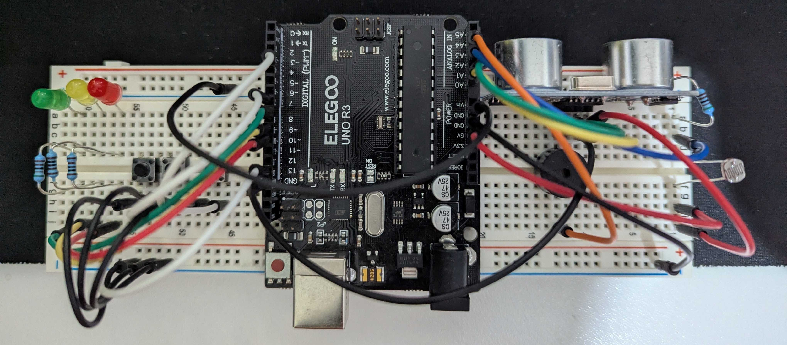
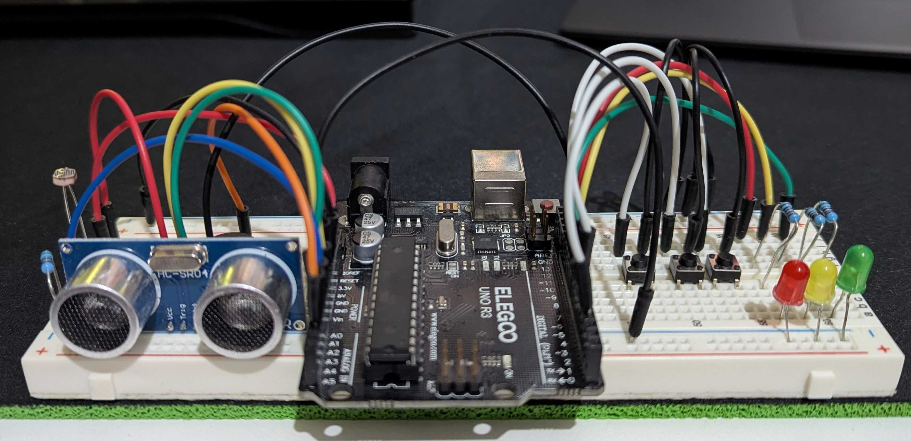
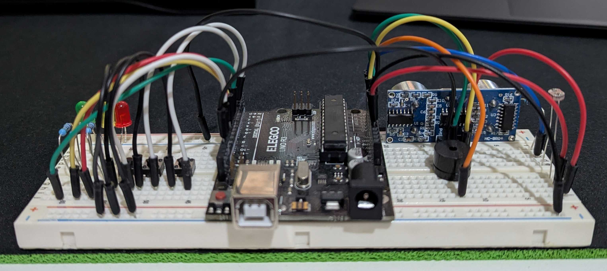

# Arduino_Traffic_Light

This is a personal project using the Arduino Uno R3 to simulate a traffic light system. The main goal was to learn about embedded systems whlist coding in C rather than using the encapsulated functions provided by Arduino.

Functions of the traffic light system: (cycled through using a pushbutton)

- Automatic Mode
  - The leds will cycle between red, yellow, and green displaying each colour for specificied durations
  - Using a ultrasonic sonar sensor, the traffic light can detect if any obstructions are within a set range
  - Using a buzzer module, the traffic light will alarm, and change the led to red if it detected any obstruction is detected
- Manual Mode
  - the leds will be frozen, showing a single colour which can then be cycled through using a second pushbutton
- Emergency Mode
  - forced the led to be locked and frozen on green
- Debugging Mode
  - using the 'Serial Monitor' extension by Microsoft, users can debug the traffic light system through USART
  - can be used to debug the sonar distance photocell brightness telemetry
- Global Features
  - Using a photocell, LED brightness is dynamically changed relative to environmental brightness

Top-View

Front-View

Back-View

